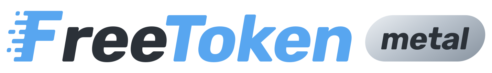

<div align="center">
  <picture>
    <source media="(prefers-color-scheme: dark)" srcset="https://raw.githubusercontent.com/FlashML-org/FreeToken-metal/main/assets/freetoken-metal-logo-dark.svg">
    <source media="(prefers-color-scheme: light)" srcset="https://raw.githubusercontent.com/FlashML-org/FreeToken-metal/main/assets/freetoken-metal-logo-light.svg">
    
  </picture>
</div>

<p align="center">
| <a href="https://arxiv.org/abs/2608.16157"><b>Paper</b></a> | <a href="https://join.slack.com/t/flashml/shared_invite/zt-3zpdh5j10-9dwTXrgLiqpVxizhA9KVbA"><b>Developer Slack</b></a> | <a href="https://discord.gg/MsA277cJzZ"><b>Community Discord</b></a> | <a href="https://github.com/FlashML-org/FreeToken/issues/482"><b>Community WeChat</b></a> |
</p>

Run frontier open-weight MoE models on the Mac you already own: FreeToken for Apple Silicon.

## About

FreeToken-metal is the Apple Silicon port of [FreeToken](https://github.com/FlashML-org/FreeToken),
an edge-native MoE serving engine, built on [MLX](https://github.com/ml-explore/mlx) and Metal.

- **Fast on Metal**: custom Metal kernels and captured decode steps keep the GPU busy.
- **Prefix caching**: multi-turn and agent sessions reuse the context they already sent.
- **MoE offload**: models larger than memory serve their experts from the SSD.
- **Models**: Qwen3.6-35B-A3B, Gemma 4, Qwen3.8-Flash-Next and Flint, with image input.
- **Agent-ready**: OpenAI and Anthropic APIs, and `ftm launch` for Claude Code, Codex, OpenCode and
  more.

Runs on Apple Silicon Macs with macOS 15 or later.

## Getting Started

Install FreeToken-metal with [uv](https://docs.astral.sh/uv/) (recommended) or pip:

```bash
uv tool install --python 3.13 freetoken-metal
ftm serve --model /path/to/Qwen3.6-35B-A3B-MLX
```

Or build it from source:

```bash
git clone https://github.com/FlashML-org/FreeToken-metal.git && cd FreeToken-metal
./install.sh
```

- [Install](https://github.com/FlashML-org/FreeToken-metal/blob/main/docs/install.md)
- [Quick start](https://github.com/FlashML-org/FreeToken-metal/blob/main/docs/quickstart.md)
- [Supported models](https://github.com/FlashML-org/FreeToken-metal/blob/main/docs/models.md)
- [CLI reference](https://github.com/FlashML-org/FreeToken-metal/blob/main/docs/cli.md)
- [Contributing](https://github.com/FlashML-org/FreeToken-metal/blob/main/CONTRIBUTING.md)

## Citation

If you use FreeToken-metal for your research, please cite the FreeToken
[paper](https://arxiv.org/abs/2608.16157):

```bibtex
@article{yang2026freetoken,
  title={FreeToken: Efficient Edge-Native MoE Serving with Bandwidth-Adaptive Execution},
  author={Yang, Shuo and Fan, Xiaoze and Pan, Melissa and Xi, Haocheng and Wang, Zhe and Sun, Shanlin and Keutzer, Kurt and Han, Song and Zaharia, Matei and Xu, Chenfeng and Stoica, Ion},
  journal={arXiv preprint arXiv:2608.16157},
  year={2026}
}
```

## Acknowledgment

FreeToken-metal is the Apple Silicon port of [FreeToken](https://github.com/FlashML-org/FreeToken)
and is built on [MLX](https://github.com/ml-explore/mlx).

## License

[Apache License 2.0](https://github.com/FlashML-org/FreeToken-metal/blob/main/LICENSE).
